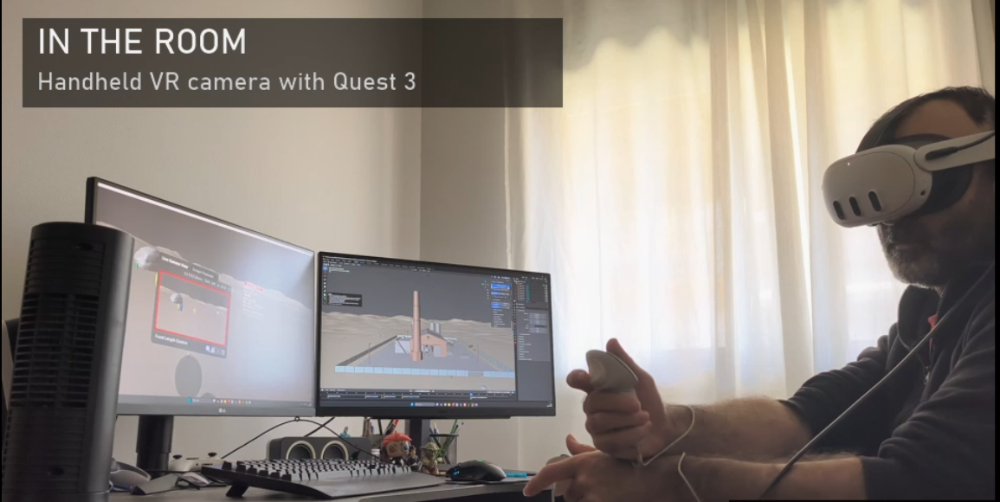
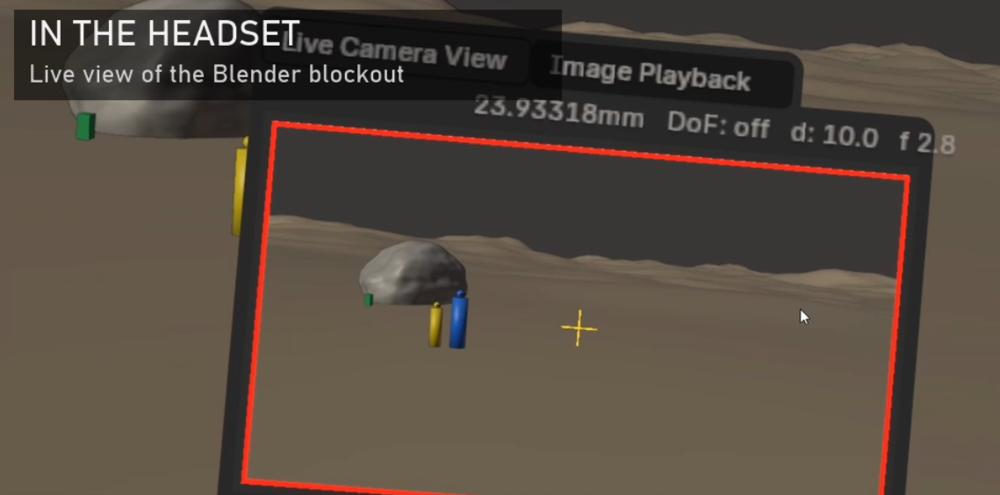
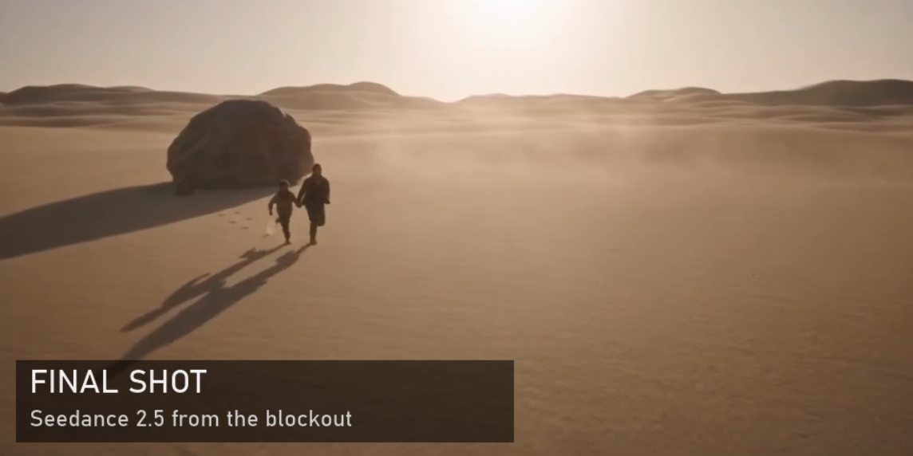

<h1>
  <picture>
    <source media="(prefers-color-scheme: dark)" srcset="docs/img/onsetvr-logo-blanco.svg">
    
  </picture>
</h1>

**Dirigir la cámara de un vídeo generado con IA rodando con el cuerpo dentro de la escena.**
*Directing the camera of an AI-generated video by shooting with your body inside the scene.*

Autor / Author: **Raül Torres Cobos** ([ORCID 0009-0004-3298-5198](https://orcid.org/0009-0004-3298-5198)) · DOI: [10.5281/zenodo.24254793](https://doi.org/10.5281/zenodo.24254793)

| En las gafas / In the headset | Plano final / Final shot |
|---|---|
|  |  |

## Qué es

OnSetVR es un método de dirección para el vídeo generado con IA: el director entra con unas gafas de realidad virtual en una maqueta de la escena y rueda la cámara a mano, toma a toma, como en un plató. Cada toma se convierte en la referencia de cámara, ritmo y puesta en escena para el modelo generativo.

- Artículo: [docs/articulo_es.md](docs/articulo_es.md)

## What it is

OnSetVR is a directing method for AI-generated video: the director steps into a blockout of the scene with a virtual reality headset and shoots the camera by hand, take after take, as on a film set. Each take becomes the camera, pacing and staging reference for the generative model.

- Article: [docs/article_en.md](docs/article_en.md)

## Disponibilidad / Availability

La herramienta no se distribuye públicamente. Para demostraciones, formación o colaboraciones, contacta con el autor a través de su perfil de ORCID. / The tool is not publicly distributed. For demonstrations, training or collaborations, contact the author through his ORCID profile.

## Cómo citar / How to cite

> Torres Cobos, R. (2026). *OnSetVR: dirigir la cámara de un vídeo generado con IA rodando con el cuerpo dentro de la escena*. Zenodo. https://doi.org/10.5281/zenodo.24254793

## Licencia / License

Textos e imágenes / Texts and images: [CC BY 4.0](https://creativecommons.org/licenses/by/4.0/). © 2026 Raül Torres Cobos.
