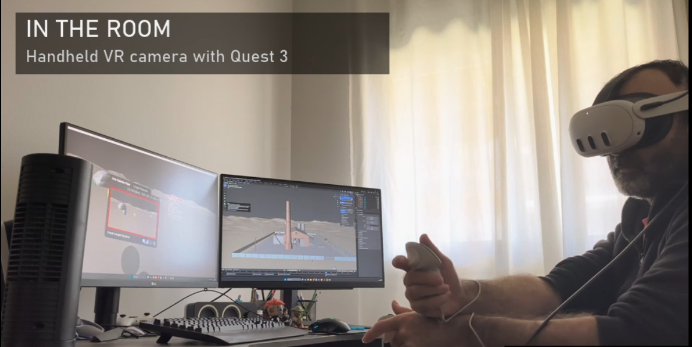
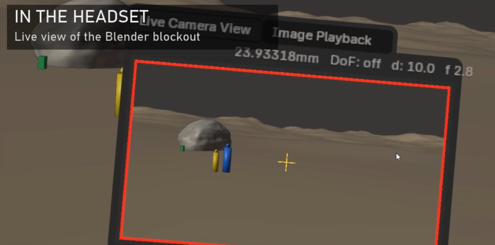
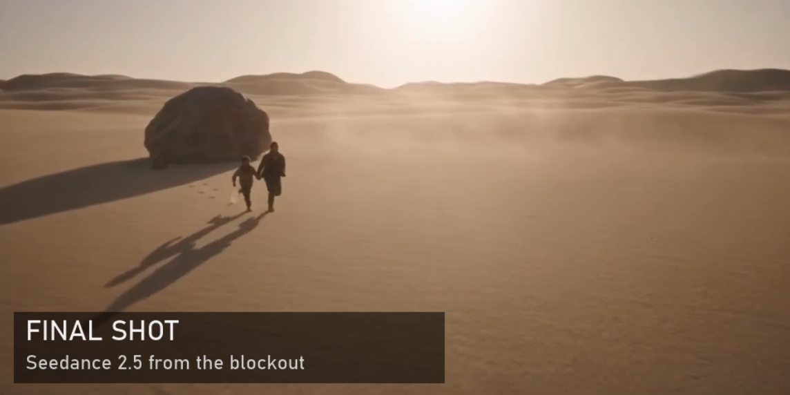

# OnSetVR: directing the camera of an AI-generated video by shooting with your body inside the scene

**Author:** Raül Torres Cobos (ORCID: [0009-0004-3298-5198](https://orcid.org/0009-0004-3298-5198))  
**Date of this version:** 15 November 2026  
**First take shot with the method:** 4 November 2026  
**License of this text:** CC BY 4.0

## Abstract

OnSetVR is a working method, and a tool of the author's own, for directing the camera of an AI-generated video the way it is done on a film set: with the body. The operator puts on a virtual reality headset, steps into a real-scale 3D blockout of the scene and shoots the camera by hand, take after take, while looking at a monitor. Each take becomes a blockout video that the generative model uses as reference for camera, pacing and staging. This document presents the method, its results and its timeline, and leaves a public, dated record of its authorship.

## From the room to the final shot

*Figure 1. In the room: the operator, wearing the headset and holding the controller that acts as the camera.*

*Figure 2. Inside the headset: the monitor of the handheld camera, framing the blockout, with the red recording frame.*

*Figure 3. Final shot, generated by the model from the blockout video.*

## 1. The problem

Generative video models produce very convincing images, but the camera has to be requested in words, and words are imprecise. Writing "tracking shot with a slight rise" is a lottery: the model decides the pacing, the distance and the framing. For a director, losing control of the camera means losing a large part of the language of film.

## 2. The idea

If the camera cannot be described well, it can be shot. OnSetVR brings to AI-generated video a way of working that anyone in the trade recognises: stepping onto the set, walking, framing, rehearsing with the actors and repeating the take until it works.

The scene does not need to be finished. A simple blockout is enough, with the volumes of the set, the positions of the characters and the timing of the action. The finish (light, materials, performance) is added later by the generative model. The camera, the framing and the pacing come from the director.

## 3. The method

1. **Blockout.** The scene is built in volumes, with the characters as moving mannequins and the action marked in time.
2. **Shoot.** The director puts on the headset and steps into the blockout at real scale, with a virtual camera in hand and a monitor showing the frame. The shoot goes take by take, as on a set: record, repeat, move the camera to a new position and start again from the beginning of the action.
3. **Reference video.** Each take is turned automatically into a clean blockout video that the model can read.
4. **Generation.** That video goes to the generative model as reference for camera, pacing and positions, together with the images that define the look of the characters and the place.
5. **Edit.** The generated shots are edited like those of any shoot.

The blockout provides what the model does not decide well from text: camera, framing, trajectories and timing. The model provides the final look.

## 4. What it contributes

This publication does not claim to have invented virtual production, which has been used for years in film and video games (for example, the virtual scouting tools of Unreal Engine or the VRtist project). What it presents is:

- **A directing method** that joins handheld camera shooting inside the scene with AI video generation, designed for directors rather than technicians.
- **A tool of the author's own** that turns that method into a shoot in takes, with the routines of a film set: rehearse, record, repeat, change camera position and pick the good one.
- **Its real use** in the production of a short film, with the results shown in this document.

As far as I have been able to check in November 2026, I am not aware of any other public work that joins camera shooting inside the scene with the creation of camera references for generative video. If one exists, I will gladly cite it.

## 5. Timeline

| Date | Milestone |
|---|---|
| 4 November 2026 | First take shot by hand inside the scene with a virtual reality headset. |
| 5 November 2026 | First shot generated with the complete method, from blockout to final video. |
| 6 November 2026 | Blockout video designed as reference for the generative model. |
| 8 November 2026 | Shooting in takes in any scene, with camera positions and the shooting script in view. |
| 11 November 2026 | The camera monitor shows the whole set, up to the horizon. |
| 15 November 2026 | Publication of the method. |

## 6. About the author

Raül Torres Cobos is a teacher, a trainer of teachers in artificial intelligence and a director of short films made with AI. OnSetVR comes from his own shoot: the need to direct the camera of an AI-generated short film with the same freedom as on a film set.

The idea, the method, the design of the tool and the tests are the author's. The code of the tool was written with the help of an AI programming assistant, directed and verified by the author.

## 7. Availability

The tool is not publicly distributed. For demonstrations, training or collaborations, the author can be contacted through his ORCID profile.

## 8. References

- Ubisoft. *VRtist*. https://github.com/ubisoft/vrtist
- Epic Games. *Virtual Scouting in Unreal Engine*. https://dev.epicgames.com/documentation/unreal-engine/virtual-scouting-in-unreal-engine

## 9. How to cite

> Torres Cobos, R. (2026). *OnSetVR: directing the camera of an AI-generated video by shooting with your body inside the scene*. Zenodo. https://doi.org/10.5281/zenodo.24254793
