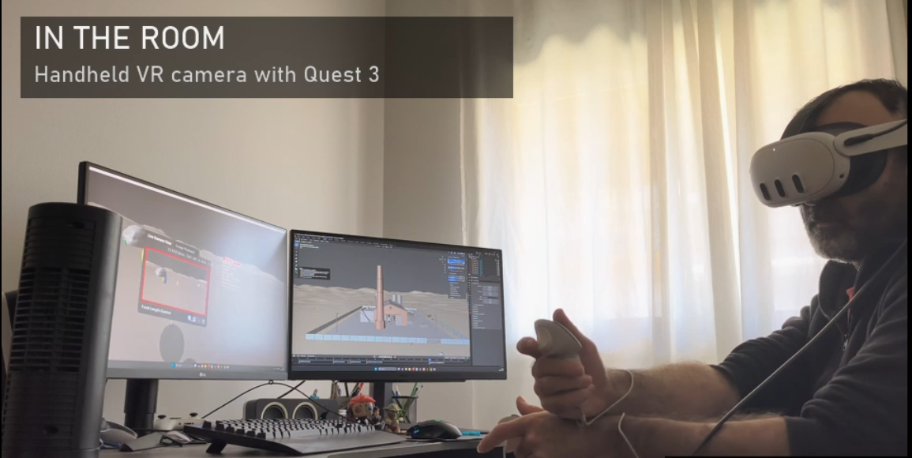
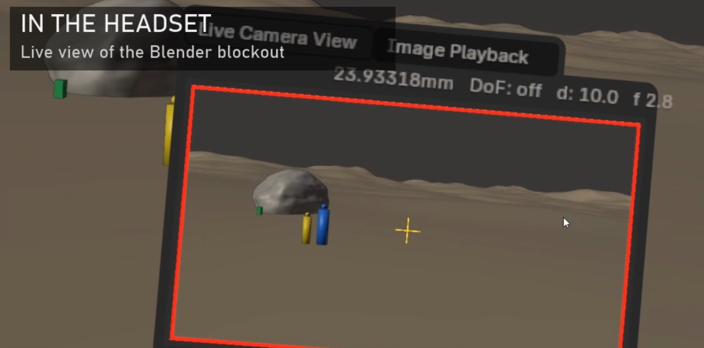
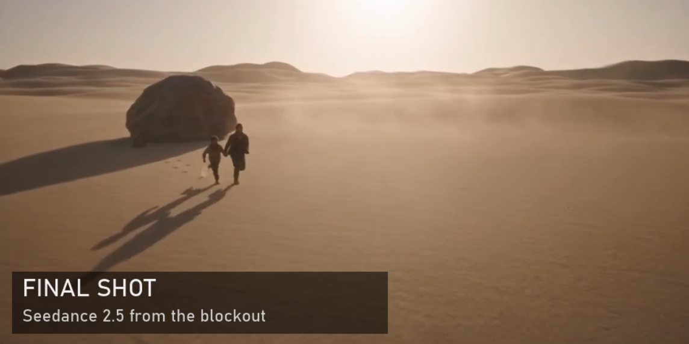

# OnSetVR: dirigir la cámara de un vídeo generado con IA rodando con el cuerpo dentro de la escena

**Autor:** Raül Torres Cobos (ORCID: [0009-0004-3298-5198](https://orcid.org/0009-0004-3298-5198))  
**Fecha de esta versión:** 15 de noviembre de 2026  
**Primera toma rodada con el método:** 4 de noviembre de 2026  
**Licencia de este texto:** CC BY 4.0

## Resumen

OnSetVR es un método de trabajo y una herramienta propia para dirigir la cámara de un vídeo generado con inteligencia artificial como se hace en un plató: con el cuerpo. El operador se pone unas gafas de realidad virtual, entra en una maqueta 3D de la escena a tamaño real y rueda la cámara a mano, toma a toma, mirando un monitor. Cada toma se convierte en un vídeo de maqueta que el modelo generativo usa como referencia de cámara, de ritmo y de puesta en escena. Este documento presenta el método, sus resultados y su cronología, y deja constancia pública y fechada de su autoría.

## De la habitación al plano final

*Figura 1. En la habitación: el operador, con las gafas puestas y el mando que hace de cámara.*

*Figura 2. Dentro de las gafas: el monitor de la cámara de mano, con el encuadre sobre la maqueta y el marco rojo de grabación.*

*Figura 3. Plano final, generado por el modelo a partir del vídeo de maqueta.*

## 1. El problema

Los modelos de vídeo generativo producen imágenes muy convincentes, pero la cámara se les pide con palabras, y las palabras son imprecisas. Escribir «travelling de seguimiento con una ligera subida» es una lotería: el modelo decide el ritmo, la distancia y el encuadre. Para un director, perder el control de la cámara es perder buena parte del lenguaje cinematográfico.

## 2. La idea

Si la cámara no se puede describir bien, se puede rodar. OnSetVR traslada al vídeo generado con IA una forma de trabajar que cualquier persona del oficio reconoce: entrar en el decorado, caminar, encuadrar, ensayar con los actores y repetir la toma hasta que sale.

La escena no necesita acabado. Basta con una maqueta sencilla, con los volúmenes del decorado, la posición de los personajes y los tiempos de la acción. El acabado (la luz, los materiales, la interpretación) lo pone después el modelo generativo. La cámara, el encuadre y el ritmo los pone el director.

## 3. El método

1. **Maqueta.** Se construye la escena en volúmenes, con los personajes como maniquíes que se desplazan y la acción marcada en el tiempo.
2. **Rodaje.** El director se pone las gafas y entra en la maqueta a tamaño real, con una cámara virtual en la mano y un monitor que le muestra el encuadre. Rueda por tomas, como en un plató: graba, repite, cambia de posición de cámara y vuelve a empezar desde el inicio de la acción.
3. **Vídeo de referencia.** Cada toma se convierte automáticamente en un vídeo de maqueta, limpio y legible para el modelo.
4. **Generación.** Ese vídeo se entrega al modelo generativo como referencia de cámara, ritmo y posiciones, junto con las imágenes que definen el aspecto de los personajes y del lugar.
5. **Montaje.** Los planos generados se montan como en cualquier rodaje.

La maqueta aporta lo que el modelo no decide bien por texto: cámara, encuadre, trayectorias y tiempos. El modelo aporta el aspecto final.

## 4. Qué aporta

Esta publicación no reclama la invención de la producción virtual, que se usa desde hace años en el cine y en los videojuegos (por ejemplo, las herramientas de exploración virtual de decorados de Unreal Engine o el proyecto VRtist). Lo que presenta es:

- **Un método de dirección** que une el rodaje de cámara a mano dentro de la escena con la generación de vídeo con IA, pensado para directores y no para técnicos.
- **Una herramienta propia** que convierte ese método en un rodaje por tomas, con las rutinas de un plató: ensayar, grabar, repetir, cambiar de posición de cámara y elegir la buena.
- **Su aplicación real** en la producción de un cortometraje, con los resultados que muestra este documento.

Hasta donde he podido comprobar en noviembre de 2026, no conozco otro trabajo público que una el rodaje de cámara dentro de la escena con la creación de referencias de cámara para vídeo generativo. Si existe, agradeceré la referencia para citarla.

## 5. Cronología

| Fecha | Hito |
|---|---|
| 4 de noviembre de 2026 | Primera toma rodada a mano dentro de la escena con unas gafas de realidad virtual. |
| 5 de noviembre de 2026 | Primer plano generado con el método completo, de la maqueta al vídeo final. |
| 6 de noviembre de 2026 | Vídeo de maqueta pensado como referencia para el modelo generativo. |
| 8 de noviembre de 2026 | Rodaje por tomas en cualquier escena, con posiciones de cámara y guion de rodaje a la vista. |
| 11 de noviembre de 2026 | El monitor de la cámara muestra todo el decorado, hasta el horizonte. |
| 15 de noviembre de 2026 | Publicación del método. |

## 6. Sobre el autor

Raül Torres Cobos es maestro, formador de docentes en inteligencia artificial y director de cortometrajes hechos con IA. OnSetVR nace de su propio rodaje: la necesidad de dirigir la cámara de un cortometraje generado con IA con la misma libertad que en un plató.

La idea, el método, el diseño de la herramienta y las pruebas son del autor. El código de la herramienta se ha escrito con la ayuda de un asistente de programación con IA, dirigido y verificado por el autor.

## 7. Disponibilidad

La herramienta no se distribuye públicamente. Para demostraciones, formación o colaboraciones, se puede contactar con el autor a través de su perfil de ORCID.

## 8. Referencias

- Ubisoft. *VRtist*. https://github.com/ubisoft/vrtist
- Epic Games. *Virtual Scouting in Unreal Engine*. https://dev.epicgames.com/documentation/unreal-engine/virtual-scouting-in-unreal-engine

## 9. Cómo citar

> Torres Cobos, R. (2026). *OnSetVR: dirigir la cámara de un vídeo generado con IA rodando con el cuerpo dentro de la escena*. Zenodo. https://doi.org/10.5281/zenodo.24254793
